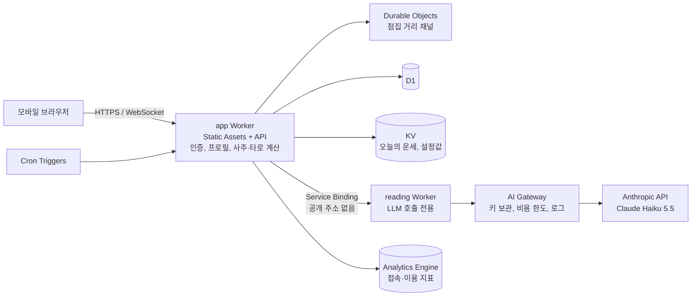
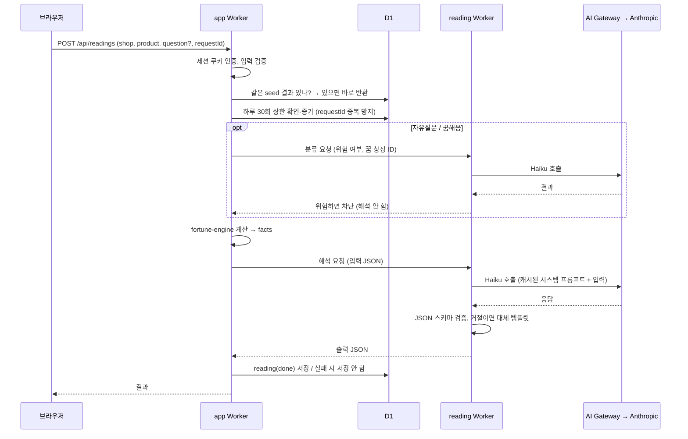

# 15. 인프라 설계

상태: ✅ 확정 (2026-11-24, D-060). 남은 것: 서비스 도메인 이름, M1 첫 주의 AI Gateway 호출 방식 확인

## 확정
- ✅ **Cloudflare만 사용**. 별도 서버 없음 (D-022, D-008과 D-013의 호스팅 부분을 대체)
- ✅ LLM은 공개 주소가 없는 내부 전용 Worker(`reading`)에서만 호출한다 (D-022)
- ✅ 프론트는 Workers Static Assets로 배포한다 (D-023)
- ✅ DB는 D1, 코드는 전부 TypeScript (D-012, D-013)
- ✅ 마을은 멀티플레이, 점집 내부는 개인 공간 (D-007). 채널 30명, 정해진 문장 + 이모트 (D-010, D-011)
- ✅ MVP는 비회원만, 결제도 복채도 없음 (D-015, D-057)
- ✅ 3D와 2D 에셋은 코드로 만들어서 별도 에셋 저장소가 필요 없다 (D-029, D-030)
- ✅ 아래 세부 설정 (D-060)

## 1. 전체 구성



## 2. 구성 요소별 역할

| 구성 요소 | 역할 | 가진 비밀값 |
|---|---|---|
| **app Worker** | 프론트 파일 제공(Static Assets), API, 익명 계정, 하루 호출 상한, `fortune-engine` 실행, 풀이 요청 조율, WebSocket 연결을 Durable Object로 전달 | 개인정보 암호화 키 `PII_KEY`, WebSocket 토큰 서명 키 `WS_TOKEN_KEY`, Turnstile 비밀 키 |
| **reading Worker** | LLM 호출 전용. app Worker가 넘긴 입력 JSON으로 프롬프트를 만들어 Haiku를 호출하고 출력을 검증해 돌려준다. **DB·KV 바인딩 없음** | 없음 (Anthropic 키는 AI Gateway가 보관) |
| **AI Gateway** | Anthropic 키 보관(BYOK), **"Require provider credentials" 켬** (Cloudflare 크레딧으로 새지 않게), 비용 한도, 호출 로그 | Anthropic API 키 (Secrets Store) |
| **D1** | 유저, 프로필, 풀이 결과, 하루 이용량, 신고 | — |
| **KV** | 오늘의 운세(미리 생성), 프롬프트 버전 같은 설정값 | — |
| **Durable Objects** | 거리 채널 1개 = 객체 1개 (SQLite 저장소). WebSocket 연결과 이동 중계 | `WS_TOKEN_KEY` (토큰 검증) |
| **Turnstile** | 익명 계정 생성 때만 봇 확인 ([F14](features/F14-session.md)) | — |
| **Cron Triggers** | 매일 12:00 KST(`0 3 * * *` UTC)에 다음 날 오늘의 운세 Batch 요청, 13:00·18:00·23:00에 결과 확인·저장 | — |
| **Analytics Engine** | 채널별 동시 접속, 점집별 이용 수, 하루 상한 도달 수 ([12](12-analytics-ops.md)) | — |

### Workers에서 LLM을 호출해도 안전한가 (2026-11-24 Cloudflare 문서로 확인)
- **키가 코드와 브라우저에 노출되지 않는다.** AI Gateway BYOK를 쓰면 키가 Secrets Store에 보관되어 Worker 코드에도 들어오지 않는다.
- **reading Worker는 인터넷에서 호출할 수 없다.** Service Binding은 공개 URL을 거치지 않는다. `workers_dev = false`, `preview_urls = false`로 공개 주소를 모두 끈다.
- **응답 대기는 CPU 시간에 들어가지 않는다.** HTTP 요청은 브라우저가 연결돼 있는 동안 시간 제한이 없다.
- **주의:** AI Gateway API 토큰은 계정 전체 권한이라 쓰지 않고, Worker의 AI 바인딩으로 호출한다. 브라우저 연결이 끊기면 `ctx.waitUntil()`로 최대 30초까지만 이어갈 수 있는데, LLM 시간 초과(20~25초)가 그 안이다.

### 설계 원칙
- reading Worker에는 DB·KV 바인딩을 주지 않는다. 계산된 입력만 받고 결과만 돌려준다
- reading Worker에는 닉네임·성별·나이대와 계산된 간지만 보낸다 (D-051)
- `fortune-engine`은 app Worker에서 실행한다. 계산은 수 밀리초 수준이라 CPU 기본 한도(30초)를 바꾸지 않는다

## 3. 풀이 요청 흐름



- ✅ 응답 방식: 완성된 결과를 한 번에 보낸다 (D-044)
- ✅ 브라우저가 끊겨도 `ctx.waitUntil()` 안에서 결과 저장까지 끝낸다. 시간 초과는 [04 §2](04-llm-spec.md#2-호출-설정) 값(20~25초)이라 30초 안에 끝난다. Workflows·Queues는 MVP에서 쓰지 않는다
- ✅ 재시도는 [04 §9](04-llm-spec.md#9-실패-처리)를 따른다 (경우마다 최대 1회)

## 4. 멀티플레이

### 채널 구조
- ✅ 채널 배정: app Worker가 정원(30명, D-011)이 안 찬 채널을 골라준다. 채널별 인원은 각 Durable Object가 KV에 30초마다 기록하고 배정 때 읽는다
- ✅ 채널 1개 = Durable Object 1개 (`village:<shopId>:<n>`, D-047)
- ✅ WebSocket Hibernation API 사용 → 접속자가 조용할 때 비용 절감

### 메시지 종류
| 방향 | 타입 | 내용 |
|---|---|---|
| 클라 → 서버 | `move` | 목적지 좌표 |
| 클라 → 서버 | `emote` | 이모트 ID |
| 클라 → 서버 | `chat` | 정해진 문장 ID만 (D-010) |
| 클라 → 서버 | `enter_shop` / `exit_shop` | 점집 ID |
| 서버 → 클라 | `snapshot` | 입장 시 현재 유저 목록 (닉네임, 아바타, 위치, 건물 안 여부) |
| 서버 → 클라 | `joined` / `left` | 유저 입퇴장 |
| 서버 → 클라 | `moved` / `emoted` / `chatted` | 다른 유저 행동 중계 |
| 서버 → 클라 | `hidden` / `shown` | 다른 유저가 건물에 들어감 / 나옴 |

- ✅ 서버 검증: 걷는 속도 2.0m/s 상한, 이모트·문장 2초에 1번, 이동 0.3초에 1번 ([F03](features/F03-street.md))
- ✅ 점집에 들어가도 연결을 유지한다 ([F04](features/F04-shop-enter.md))
- ✅ 재접속: 1, 2, 4, 8초 간격으로 최대 5번, 같은 채널로 ([F03](features/F03-street.md))
- ✅ **WebSocket 인증:** app Worker가 `userId·채널·만료(5분)`에 HMAC 서명한 토큰을 발급하고, Durable Object가 `WS_TOKEN_KEY`로 검증한다. 메시지는 JSON, 1개 최대 512바이트

### 개인 공간 (점집 내부)
- 점집 내부는 서버 동기화 없음. 클라이언트에서만 렌더링한다
- 점 보기는 위 [풀이 요청 흐름](#3-풀이-요청-흐름)의 HTTPS API만 사용한다

## 5. 환경 분리
| 환경 | 용도 | 접근 | 배포 |
|---|---|---|---|
| local | 개발 | `wrangler dev` (Vite 플러그인)로 app·reading·realtime을 함께 실행. LLM은 실제 호출 또는 고정 응답 모드 | — |
| staging | 출시 전 확인 | Cloudflare Access로 팀만 접근 | `staging` 브랜치 |
| prod | 서비스 | 공개 (app Worker만) | `main` 브랜치 |

- ✅ 환경마다 D1, KV, Durable Object 네임스페이스, AI Gateway, Anthropic API 키를 **따로** 둔다
- ✅ 도메인: prod `<서비스 도메인>`, staging `staging.<서비스 도메인>`. ⬜ **도메인 이름은 정해야 한다** (구매 필요)
- ✅ local의 "고정 응답 모드": `LLM_MODE=fixture`면 reading Worker가 `packages/prompts/fixtures/`의 저장된 응답을 돌려준다 (비용 없이 개발)

## 6. reading Worker 설정
| 항목 | 내용 |
|---|---|
| 공개 주소 | `workers_dev = false`, `preview_urls = false`, 라우트 없음 (D-022) |
| 호출 경로 | app Worker의 Service Binding, RPC 메서드 방식 (`interpret()`, `classify()`) |
| 바인딩 | AI 바인딩(AI Gateway)만. D1·KV 없음 |
| 키 보관 | AI Gateway BYOK + "Require provider credentials" |
| 호출 시간 초과 | 해석 20초(무료 점) / 25초(사주 정밀), 분류 10초 ([04 §2](04-llm-spec.md#2-호출-설정)) |
| 로그 | 개인정보 제외. 요청 ID, 점집, 상품, 토큰 수, 지연 시간, `stop_reason`만 |

- ✅ **호출 방식:** Worker의 AI 바인딩으로 AI Gateway를 거쳐 Anthropic을 부른다. **M1 첫 주에 확인할 것:** 이 경로로 구조화 출력(`output_config.format`)과 프롬프트 캐싱(`cache_control`)이 그대로 전달되는지. 안 되면 Anthropic SDK의 `baseURL`을 AI Gateway의 Anthropic 엔드포인트로 바꾸는 방식으로 간다 (키는 여전히 BYOK)
- ✅ **AI Gateway 비용 한도:** 게이트웨이 전체 하루 $10 (넘으면 그날 LLM 호출 차단 → 대체 문장). 50% 도달 시 알림
- ✅ Anthropic 콘솔에도 월 사용 한도 $300을 걸어 이중 안전장치로 둔다
- ✅ Cloudflare 결제 설정에서 Workers·Durable Objects 사용 금액 알림을 건다 (월 $20, $50)

## 7. 배포
- ✅ Git 저장소는 GitHub
- ✅ PR 검사: GitHub Actions에서 린트, 타입 검사, 단위·통합 테스트 ([13 §3](13-tech-architecture.md#3-코딩-규칙))
- ✅ 배포: Workers Builds가 브랜치를 보고 배포한다. `staging` → staging, `main` → prod
- ✅ 배포 순서: D1 마이그레이션(`wrangler d1 migrations apply`) → reading Worker → realtime → app Worker
- ✅ 마이그레이션은 **이전 버전 코드와도 동작하게** 쓴다 (칼럼 추가 먼저, 삭제는 다음 배포에서)
- ✅ 롤백: 코드는 Workers 버전 롤백(`wrangler rollback`), 데이터는 D1 Time Travel

## 8. 보안
- ✅ 비밀값은 Worker secret과 Secrets Store(AI Gateway BYOK)에만 둔다. Wrangler 설정의 `vars`에는 넣지 않는다
- ✅ 개인정보(생년월일, 출생 시간) 필드는 AES-GCM으로 암호화해 저장한다. 키는 `PII_KEY` secret, 키 버전을 같이 저장해 키를 바꿀 수 있게 한다
- ✅ 속도 제한: 풀이 요청(사용자당 하루 30회), 익명 계정 생성(IP당 하루 5개), WebSocket 메시지 ([F03](features/F03-street.md))
- ✅ 익명 계정을 반복 생성해 하루 상한을 피하는 악용 방지: Turnstile + IP당 하루 5개 ([F14](features/F14-session.md)) + AI Gateway 하루 $10 한도
- ✅ CORS: 앱 도메인만 허용 (API와 프론트가 같은 도메인이라 기본적으로 불필요)
- ✅ CSP 헤더:
  ```
  default-src 'self';
  script-src 'self' https://challenges.cloudflare.com;
  frame-src https://challenges.cloudflare.com;
  connect-src 'self' wss://<서비스 도메인>;
  img-src 'self' data: blob:;
  style-src 'self' 'unsafe-inline';
  ```
- ⏸ 결제 웹훅 검증은 유료화 때 (D-057)

## 9. 모니터링
| 대상 | 도구 | 알림 기준 |
|---|---|---|
| Workers 오류율·지연 | Workers Logs + Traces 켬 | 5xx 비율 2% 초과가 5분 이어지면 이메일 |
| LLM 비용·오류·지연 | AI Gateway 분석 + 비용 한도 | 하루 $5(한도의 50%) 도달 시 이메일, 거절·오류율 5% 초과 |
| 동시 접속, 채널 수, 이용 수 | Analytics Engine | 기록만 (알림 없음) |
| 프론트 오류 | `/api/client-errors`로 보내 Workers Logs에 남긴다 (외부 서비스 안 씀) | 5분에 100건 초과 |

- ✅ 알림은 Cloudflare Notifications로 운영자 이메일에 보낸다

## 10. 백업과 장애 대응
- ✅ D1 백업: Time Travel로 지난 30일 중 어느 분으로든 되돌릴 수 있다 (유료 요금제). 따로 켤 필요 없음
- ✅ Anthropic API 장애 또는 AI Gateway 한도 도달: 새 풀이를 막고 캐릭터 말투로 안내. 다시 보기·오늘의 운세(KV에 있는 것)는 계속 된다
- ✅ 멀티플레이 장애: 거리를 혼자 모드로 바꿔 점 보기는 계속 가능 ([F03](features/F03-street.md))

## 11. 비용 추정 (월, 가정: 하루 이용자 1,000명 × 풀이 3회)
| 항목 | 산정 | 금액 (추정) |
|---|---|---|
| Cloudflare Workers 유료 요금제 | 기본료 + 포함량 안에서 운영 예상 (무료 요금제는 요청당 CPU 10ms라 부족) | 월 $5 안팎 (요금 확인 필요) |
| Durable Objects, D1, KV, Analytics Engine | 위 규모는 대부분 포함량 안 | $0~10 |
| Anthropic (Haiku 5.5) | 하루 3,000회 × 1회 약 $0.002 (입력 2.5K, 출력·thinking 3K 토큰) | 약 $180 |
| 오늘의 운세 | 하루 10건, Batch 50% 할인 | $1 미만 |
| 도메인 | | 연 2~3만 원 |

- 하루 $10 AI Gateway 한도면 하루 약 5,000회까지 버틴다. 이용자가 늘면 한도와 이 표를 같이 올린다
