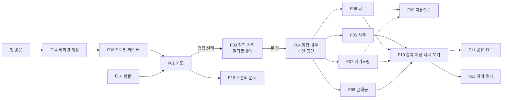

# MVP 기능 명세

기능 하나당 문서 하나. [템플릿](../templates/feature-spec-template.md) 형식을 따른다. **상태가 ✅인 명세만 구현을 시작한다** ([13 §3](../13-tech-architecture.md#3-코딩-규칙)).

## 사용자 흐름

## 목록

| ID | 기능 | 화면 | 마일스톤 | 상태 |
|---|---|---|---|---|
| [F01](F01-map.md) | 지도 / 점집 선택 | S1 | M1 | ✅ |
| [F02](F02-profile.md) | 프로필 입력 / 캐릭터 생성 | S2 | M1 | ✅ |
| [F03](F03-street.md) | 점집 거리 이동 / 멀티플레이 | S3 | M1(이동), M3(멀티) | ✅ |
| [F04](F04-shop-enter.md) | 점집 입장 / 화면 전환 | S3→S4 | M2 | ✅ |
| [F05](F05-saju.md) | 사주 풀이 | S4-1 | M2 | ✅ |
| [F06](F06-tarot.md) | 타로 풀이 | S4-2 | M2 | ✅ |
| [F07](F07-dolyeong.md) | 아기도령 오방기 | S4-3 | M2 | ✅ |
| [F08](F08-dream.md) | 꿈해몽 | S4-4 | M2 | ✅ |
| [F09](F09-free-question.md) | 자유질문 | S4-2, S4-3 | M4 | ✅ |
| [F16](F16-gunghap.md) | 같이 보기 (지도에서 초대, 점집마다 같이 보는 점) | S1·S3·S4 | M3 | ✅ |
| [F17](F17-avatar-style.md) | 캐릭터 꾸미기 (종족·머리·옷·장식) | S2·내 캐릭터 | M1 | ✅ |
| [F10](F10-history.md) | 결과 저장 / 다시 보기 | S5 | M2 | ✅ |
| [F11](F11-share.md) | 결과 공유 카드 | S5 | M4 | ✅ |
| [F12](F12-coins.md) | 복채 지급 / 사용 | 공통 | M6 | ⏸ MVP 제외 (D-057) |
| [F13](F13-daily.md) | 오늘의 운세 | S1 | M2 | ✅ |
| [F14](F14-session.md) | 비회원 계정 생성 / 유지 | S0 | M1 | ✅ |
| [F15](F15-followup.md) | 이어 묻기 (풀이에 이어 질문) | S5 | M2 | ✅ |

## 공통 규칙
- 모든 API는 app Worker를 거친다 ([15](../15-infrastructure.md)). 경로는 [09 §3](../09-backend-data.md#3-api-목록-초안)
- **MVP의 모든 점은 무료이고 복채가 없다 (D-057).** 비용은 사용자당 하루 LLM 호출 30회 상한과 계정 생성 제한(F14)으로 막는다
- 점 요청은 모두 `requestId`(클라이언트가 만든 UUID)를 보내 같은 요청이 두 번 처리되지 않게 한다
- 점 결과는 seed로 고정되고 저장된다. 같은 조건으로 다시 보면 저장본을 보여준다 ([03](../03-tarot-and-other-readings.md#공통-결과-고정-규칙))
- 오류 문구는 그 화면의 캐릭터 말투로 쓴다 ([04a](../04a-persona-prompts.md))
